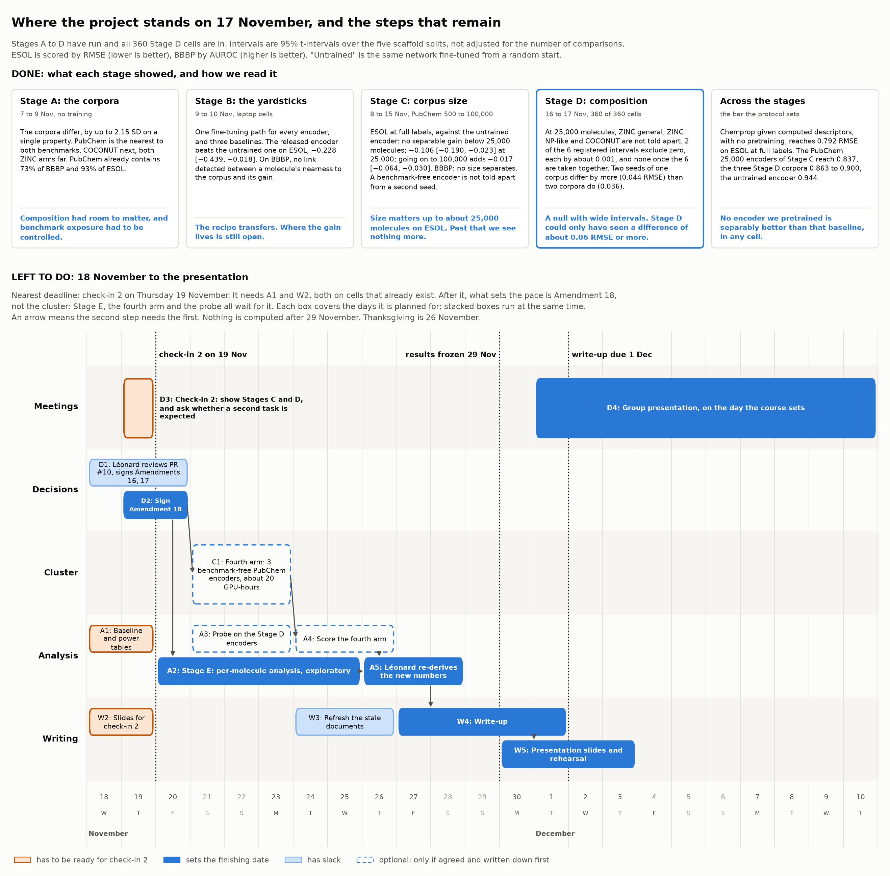

# Where the project stands, and the steps that remain

Written on 17 November 2026, after the last of the 360 Stage D cells came in and
before check-in 2. It replaces the plan drawn that afternoon, while the last
encoder was still training. That plan turned on one question, "are all 360
cells in?". They are, so its diagram is gone: `figures/remaining-steps.png` is
now the diagram of this page, drawn by `scripts/plot_remaining_steps.py`.

Stage C and Stage D numbers below were read from the tables in `docs/results/`
or recomputed from the raw cells on 17 November. Stage A and Stage B numbers are
quoted from `docs/check-in-1-report.md` and the Stage B notebook and were not
recomputed. Intervals are 95% t-intervals over the five splits and are not
adjusted for the number of comparisons, unless the sentence says otherwise.
They use the exact t quantile; the Stage C tables use 2.776, which moves one
bound printed here by 0.001. In the tables, bold marks an interval that
excludes zero.

## The short version

- **Stages A to D have run.** What is left is analysis (Stage E), the documents,
  Léonard's reading of Amendments 16 and 17, and the write-up due 1 December.
- **Size (Stage C).** On ESOL at full labels, pretraining first beats the
  untrained encoder at 25,000 molecules, by 0.106 RMSE [0.023, 0.190], and
  100,000 adds nothing we can detect over 25,000 (−0.017 [−0.064, +0.030]). On
  BBBP no corpus size separates from the untrained encoder.
- **Composition (Stage D).** At 25,000 molecules the three corpora are not told
  apart. Two of the six registered intervals exclude zero, each by about 0.001,
  and neither does once the six are taken together. This is a null with wide
  intervals: a difference of up to about 0.08 RMSE on ESOL is still allowed.
- **What nobody planned for.** Chemprop given computed descriptors, with no
  pretraining at all, is as good as or better than every encoder we pretrained,
  at every label budget on ESOL.
- **The Stage D script, tables and figures were checked and are in pull request
  #10** (branch `feat/stage-d-composition`), which waits for Léonard's review.
  The numbers were right. Two figures and the script's safety checks were fixed
  first; the tables did not change.

## What the results mean

Our reading, from the surest to the least sure. The tables it rests on are
further down, and so is the wording it must not slide into.

1. **How many molecules matters, and the gain arrives late and stops early.**
   On ESOL at full labels no corpus under 25,000 molecules is separably better
   than the untrained encoder, and at 1,000 the interval is on the harmful side. At
   25,000 the gain is 0.106 RMSE. Four times more molecules add nothing we can
   see. This holds for one task, one label budget and one control.
2. **Pretraining at this scale does not beat feeding the descriptors in.**
   Chemprop with computed descriptors and no pretraining reaches 0.792 RMSE on
   ESOL at full labels. The untrained encoder is at 0.944 and the PubChem
   25,000 encoders at 0.837. No encoder we pretrained is separably better than
   that baseline in any cell, and at 50 labels our 100,000-molecule encoder is
   worse than it by 0.186 [0.058, 0.315].
3. **Which molecules: Stage D cannot tell, and that is its result.** On ESOL at
   full labels the three arms sit at 0.900 (ZINC general), 0.876 (COCONUT) and
   0.863 (ZINC NP-like), all between the untrained encoder and the PubChem
   reference. They are 0.036 apart from first to last. Two seeds of one arm are
   0.044 apart, and the design could detect about 0.06. What the 360 cells
   allow us to say is a bound: at 25,000 molecules, a composition effect on
   ESOL is smaller than about 0.08 RMSE, and on BBBP smaller than about 0.03
   AUROC. They do not allow "composition does not matter".
4. **Natural products: no sign that origin adds anything to resemblance.**
   COCONUT against ZINC NP-like is the tightest comparison in Stage D, +0.013
   [−0.014, +0.040] on ESOL. But neither benchmark is a natural-product task,
   so the sharp form of the hypothesis (a natural-product corpus helps on
   natural-product-like molecules) was not put to a test. One exploratory look,
   below, points that way and no further.
5. **Nearness to the benchmark may be what a corpus buys. We cannot claim it.**
   PubChem, the corpus nearest to ESOL in Stage A, is ahead of all three arms
   by 0.026 to 0.062 RMSE. The comparison is not registered, and the PubChem
   encoders kept their benchmark molecules and have two seeds. The optional
   fourth arm below exists to close exactly this.
6. **BBBP after fine-tuning says nothing either way.** At full labels the three
   arms, the PubChem reference, Chemprop with descriptors and the untrained
   encoder all score between 0.916 and 0.932 AUROC, and no interval against the
   untrained encoder excludes zero.

The project set itself this test on 8 November: "A clear null result counts as
success. We succeed if we can say how large any difference is and whether it
holds outside the pretraining chemistry." The first half is met: the difference
between corpora is bounded, and so is what size buys. The second half is what
Stage E is for.

## What was checked before Stage D was committed

Five independent checks ran on 17 November, each followed by a second pass
whose job was to refute what the first reported.

| Check | Result |
|---|---|
| Both tables recomputed from the raw cells (the 360 Stage D cells and the 160 reference cells) by separately written code, with its own AUROC and RMSE | Every value agrees to 1e-15. Done twice, by two programs that did not read the script. |
| The 360 cells as data | One complete grid (3 arms × 3 seeds × 2 tasks × 5 splits × 4 budgets). One code version. Each cell fine-tuned from its own encoder's checkpoint, the nine checkpoints all different. Same test molecules and labels as the Stage C cells of record. No missing or infinite prediction. |
| The 30 jobs | All COMPLETED. Only COCONUT seed 1 was preempted (three times); it resumed each time from its last checkpoint, at the start of the interrupted epoch, with its optimiser state. The Slurm log shows the last resume only; the earlier ones are in the training logs. 59.1 GPU-hours in all, about 6.5 per encoder. |
| The nine corpora | 25,000 molecules each, no duplicate, descriptor standardisation byte-identical to the Stage C reference. Nothing in Amendment 17 differs from what ran, on one reading that has to be stated: "removed" means removed by exact canonical SMILES (below). |
| The three figures against the tables | Every mean, interval end and printed number matches. Every factual sentence printed on them was verified against the data. |

What the checks found, and what was done about it:

| Finding | Action |
|---|---|
| On the slide figure the value labels sat on white boxes that hid five of the thirty per-split dots, including the dot nearest zero of one of the two intervals that exclude zero. | Fixed. Labels now sit beyond the interval, on the side away from zero. |
| The headline title said "five splits do not separate the three corpora" as a fixed string, above a computed line saying two of six registered intervals exclude zero. | Fixed. The title is now counted from the table: "2 of the 6 registered intervals exclude zero, none once the 6 are taken together". |
| The script accepted a reference cell filed under the wrong name, a low-label reference cell from before Amendment 16, a probe or delayed-unfreezing cell, and a cell with different test labels. None of these exists in the real data. | Fixed. All four are now refused. The script still does not compare the other recipe fields (epoch cap, learning rate, batch size); those are the same in all 520 cells. |
| **Benchmark molecules were removed by exact canonical SMILES, stereochemistry included.** Each COCONUT draw still holds 65 to 71 molecules (0.3%) that match a BBBP or ESOL molecule once stereochemistry is ignored. The ZINC draws hold none. | Stated on the figures and in `docs/results/stage-d/README.md`. The write-up has to say it. Its effect on scores was not measured. The Stage C exposure check (one encoder, 100,000 molecules) could not tell the removal of 260 benchmark molecules from a seed-to-seed difference. |
| Git cannot show that Amendment 17 was written before the scores: it was committed on 17 November at 00:24, after 320 of the 360 cells existed. The file's last save was 14 seconds before the jobs were submitted, and the config digest taken at submission matches. | Stated here. Nothing to fix. |
| Every Stage D manifest says `tree_dirty: true`, so its commit does not name the code that ran. | The digests taken at submission are now tracked in `docs/results/stage-d/code.sha256` and still verify. |

## What happened so far, step by step

| When | Step | Outcome | What went wrong or changed |
|---|---|---|---|
| 7 Nov | **Plan.** After the 2 November call the order was inverted: corpus size first, composition second, five stages A to E. | Stage D was to run "at the size Stage C shows is on the flat part". | |
| 7–9 Nov | **Stage A.** Corpora cleaned, ZINC sampled across 250 shards, five scaffold splits frozen, corpora compared. | The corpora differ (largest property gap 2.15 SD). PubChem is nearest to both benchmarks (ESOL nearest-neighbour similarity 0.54), COCONUT next (0.46), both ZINC arms far (0.30). PubChem contains 73% of BBBP and 93% of ESOL. | ZINC shards are sorted by weight, so whole shards were replaced by a spread sample. Eleven unparseable BBBP rows were dropped from the splits. |
| 8–9 Nov | **Stage C, pretraining.** Fourteen encoders on nested PubChem subsets, 500 to 100,000 molecules, two seeds. | All fourteen finished, 66.6 GPU-hours, every run stopped early. | Real throughput was about two thirds of the pilot's. The 100,000 runs were started before their gate. |
| 9 Nov | **Linear probe** on frozen encoders, 720 cells. | BBBP separates sizes; ESOL was unreadable. | Four claims made too early were withdrawn. The ESOL problem was later traced to near-dead embedding dimensions and corrected with a cap (`runs/probe_clipped`). |
| 9–10 Nov | **Stage B.** One fine-tuning path for every arm, three baselines, the per-molecule proximity analysis. Amendments 1 to 15. | Released encoder against untrained on Léonard's laptop: ESOL −0.228 [−0.439, −0.018]. Proximity slope on BBBP at full labels, the pre-specified cell (interval clustered on the molecule): 0.024 [−0.050, +0.098], no association detected. | The 50-epoch cap was binding and unequal (Amendment 13). Amendment 15 corrected three inference errors after an independent read. |
| 10 Nov, forest 12 Nov | **Stage C, fine-tuning.** 18 neural arms × 40 cells on the cluster, plus the forest. | 760 cells. | The working tree was not clean, so the recorded commit does not name the code. |
| 12–13 Nov | **Audit and Amendment 16.** The 50 and 100 label cells had one or two optimiser steps per epoch. An epoch now has at least eight. | 380 cells re-run into `runs/finetune_a16`. ESOL at 50 labels, PubChem 25k minus untrained: −0.647 as registered, −0.428 after. | Post hoc, written after scores were read. Both versions are kept and reported. |
| 13–14 Nov | **Exposure check.** One 100,000-molecule encoder with no benchmark molecule in its corpus. | No difference beyond seed to seed: ESOL −0.017 [−0.087, +0.052], BBBP +0.0005 [−0.006, +0.007]. | One encoder, and it is a fresh draw, so exclusion and resampling are confounded. |
| 15 Nov | **Stage C result.** | Table below. | |
| 16 Nov | **Amendment 17 and launch of Stage D.** 25,000 molecules; `zinc_general`, `zinc_nplike`, `coconut`; benchmark molecules removed; three seeds; thirty jobs. | | 25,000 is where the effect first appears, not the flat part the plan asked for. Decided by Gabriel alone. |
| 16–17 Nov | **Stage D runs.** | 360 cells, thirty jobs COMPLETED. | One encoder preempted three times. |
| 17 Nov | **Stage D result**, checked as above. PR #9 (Amendments 16 and 17, Stage C tables) merged into `main`. | Table below. | PR #9 had no human review. Léonard has signed neither amendment. |

Stage C, each PubChem size minus the untrained encoder, full labels:

| Molecules | ESOL, RMSE (below zero is better) | BBBP, AUROC (above zero is better) |
|---:|---|---|
| 500 | +0.104 [−0.017, +0.225] | −0.006 [−0.029, +0.016] |
| 1,000 | **+0.051 [+0.006, +0.096]** | −0.008 [−0.033, +0.017] |
| 5,000 | −0.042 [−0.143, +0.058] | −0.001 [−0.018, +0.016] |
| 10,000 | −0.053 [−0.140, +0.035] | +0.002 [−0.022, +0.027] |
| 25,000 | **−0.106 [−0.190, −0.023]** | +0.006 [−0.016, +0.028] |
| 50,000 | −0.112 [−0.239, +0.014] | +0.009 [−0.005, +0.023] |
| 100,000 | **−0.123 [−0.237, −0.010]** | +0.007 [−0.005, +0.020] |
| released, 944,286 | **−0.156 [−0.290, −0.022]** | +0.014 [−0.011, +0.038] |
| Chemprop + descriptors, not pretrained | −0.151 [−0.327, +0.025] | +0.006 [−0.030, +0.042] |

Stage D, the six registered comparisons, full labels:

| Comparison | ESOL, RMSE | BBBP, AUROC |
|---|---|---|
| ZINC NP-like − ZINC general (the filter) | **−0.036 [−0.071, −0.001]** | −0.002 [−0.019, +0.016] |
| COCONUT − ZINC general (natural products) | −0.023 [−0.080, +0.033] | **+0.008 [+0.001, +0.015]** |
| COCONUT − ZINC NP-like (from nature, or looks like it) | +0.013 [−0.014, +0.040] | +0.010 [−0.014, +0.033] |

## How the results line up with what we set out to test

| What we expected | What the data says | Verdict |
|---|---|---|
| **The size curve flattens early**, around 50,000 molecules. | On ESOL at full labels 25,000 beats 5,000 (−0.064 [−0.113, −0.015]) and 100,000 does not beat 25,000 (−0.017 [−0.064, +0.030]). Below 5,000 pretraining does not help; at 1,000 the interval is on the harmful side. | Partly supported, on ESOL at full labels only. "Flat" holds between 25,000 and 100,000 within about ±0.05, not below, and the released encoder is better than our 100,000 at 50, 100 and 500 labels. |
| **Pretraining beats the same network untrained.** | ESOL at full labels: the interval excludes zero at 25,000, at 100,000 and for the released encoder, not at 50,000. ESOL at 50 labels (the recipe of Amendment 16, post hoc): from 1,000. BBBP: one interval of 32 excludes zero, by 0.0005. | Supported on ESOL. Unresolved on BBBP. |
| **A pretrained encoder beats Chemprop with descriptors.** The protocol says one that does not "has not earned its compute". | In no cell is any encoder separably better than it. On ESOL its means are 1.211 / 1.196 / 0.839 / 0.792 at 50 / 100 / 500 / all labels; our 100,000 encoder has 1.397 / 1.248 / 0.932 / 0.820 and is worse at 50 labels by 0.186 [0.058, 0.315]. | Not supported. |
| **Pretraining helps most at low labels.** | True against the untrained network on ESOL (−0.48 at 50 labels against −0.12 at full labels for 100,000 molecules). False against Chemprop with descriptors. Not shown on BBBP. | Partly supported. Depends on the comparator. |
| **Benchmark exposure does not drive the curve.** | The benchmark-free encoder is not distinguishable from a seed-to-seed difference at any budget. | Supported, as "not distinguishable", with an interval that still allows 0.09 RMSE. |
| **Composition matters at a fixed size.** | Table above. Two of six intervals exclude zero by 0.001; none after Bonferroni over six. Secondary budgets: 0 of 18. | Unresolved. Not "no effect". |
| **The NP-like arm separates looking like a natural product from being one.** | COCONUT − ZINC NP-like on ESOL is +0.013 [−0.014, +0.040]: the tightest bound in Stage D, and no sign that origin adds anything. | Unresolved. Neither benchmark is a natural-product task, so the sharp version of the hypothesis was never put to a test. |
| **The gain concentrates on molecules near the corpus.** | Stage B slope on BBBP at full labels 0.024 [−0.050, +0.098], from the laptop cells only. | Not supported there, and not re-run on the cluster. Stage E is where this is asked again. |

## What to learn from it

1. **The registered Stage D comparison sat where there was least to modulate.**
   At full labels none of the three arms is itself separable from the untrained
   encoder on ESOL (−0.044, −0.080, −0.067, every interval covering zero). At
   50 labels all three are (−0.35 to −0.43), but there the corpus-against-corpus
   intervals are ±0.07 to ±0.16.
2. **The design could detect about 0.06 RMSE and 0.024 AUROC** between two arms
   at full labels (80% power, from the standard errors of the registered pairs;
   no script in the repo computes this yet). The whole pretraining gain of these arms over
   the untrained encoder is 0.04 to 0.08 RMSE. So Stage D could only have seen
   a composition effect about as large as the pretraining effect itself.
   Amendment 17 planned on "about ±0.08"; that figure was the half-width of one
   seed-pair interval and is not the detection limit.
3. **The two intervals that exclude zero should not be read as findings.** Inside
   `zinc_general` alone, seed 1 beats seed 0 on ESOL by 0.044 [0.021, 0.068],
   more than the 0.036 between `zinc_nplike` and `zinc_general`. With one seed
   per arm, matched by seed number, neither comparison excludes zero. Leaving one split out, the ESOL
   interval excludes zero in one of five cases and the BBBP one in two of five.
4. **The clearest corpus difference in the data is one we did not register.**
   All three Stage D arms are behind the Stage C PubChem encoders of the same
   size on ESOL at full labels: +0.062 [+0.017, +0.107], +0.026 [+0.010,
   +0.042], +0.039 [+0.010, +0.068]. It cannot be claimed: the PubChem encoders
   kept 65 to 67 benchmark molecules, have two seeds against three, and are
   the corpus the descriptor targets were standardised on. Only the two ends
   match Stage A's proximity table (PubChem nearest and best, ZINC general
   furthest and worst): ZINC NP-like, as far from ESOL as ZINC general, is
   ahead of COCONUT.
5. **One reading, not tested: pretraining at this scale buys back what an
   oversized untrained network loses.** Plain Chemprop, with 227,700 encoder
   parameters and no pretraining, sits at the same distance from the untrained
   encoder as our 100,000-molecule, 8.7-million-parameter encoder on ESOL at
   full labels (−0.127 and −0.123, both with wide intervals).
6. **BBBP with fine-tuning carries almost no information for this question.**
   Under the frozen probe every size from 10,000 up separates from the random
   encoder on BBBP (25,000: +0.031 [+0.004, +0.057], capped probe). After
   fine-tuning on 1,631 labels none separates from the untrained one.
7. **Five splits resolve encoder against encoder far better than encoder
   against untrained.** Half-widths on ESOL are 0.03 to 0.06 RMSE for the Stage
   D pairs, against 0.08 to 0.13 for a corpus of 25,000 or more against the
   untrained encoder. The untrained control is one initialisation per split.
8. **A recipe counted in epochs has to be checked in optimiser steps** before
   the first low-label run. Amendment 16 exists because it was not.

## What we did not try, and what to test now

Ranked by what each closes for what it costs. The fork to watch is always the
same: anything chosen after the scores were read is exploratory unless it is
written into an amendment, signed by both, before the new numbers exist.

### From the cells we already have: no training, first in line

| # | What | Why | Cost |
|---|---|---|---|
| 1 | **Every encoder against Chemprop with descriptors and plain Chemprop**, at all four budgets, in one table with nothing selected. | The protocol asks this question itself and the answer changes the headline: pretraining at this scale recovers what the oversized untrained network loses and does not beat feeding the descriptors in. The slides say so for full labels only. | 2 to 3 hours, no compute. |
| 2 | **What Stage D could detect**, in the Stage D table: 0.06 RMSE and 0.024 AUROC at full labels. Beside it, an interval that also counts the pretraining draw, in columns marked "not registered". | It replaces the wrong "±0.08" and stops the two near-zero intervals being read as findings. A first computation gives ESOL [−0.083, +0.011] and BBBP [−0.001, +0.017] for the two, both covering zero; a second defensible version leaves them excluding zero, so both versions are printed. The detection limits and these four bounds were computed in scratch scripts and have to be regenerated by a script in the repo before they are quoted. | 3 to 4 hours, no compute. |
| 3 | **Stage E on the Stage D encoders**: per-molecule error of one arm minus another, against the test molecule's similarity to each encoder's own corpus and against its natural-product-likeness. All of it labelled exploratory. | It is the planned stage, it needs no training, and it is the only place the sharp version of the hypothesis (a natural-product corpus helps on natural-product-like molecules) can be looked at. The far bin Stage B lacked exists here. In a first look, about nine in ten ESOL test molecules have no neighbour above 0.4 similarity in a ZINC corpus, about half in a COCONUT corpus and about a fifth in a PubChem one (mean nearest-neighbour similarity 0.30, 0.46 and 0.55). | 6 to 8 hours, minutes of CPU. Waits for Amendment 18. |

A first look at item 3 has already been taken, so it cannot be called
pre-specified. On ESOL at full labels, the absolute error of the COCONUT
encoders minus the ZINC general encoders is +0.033, −0.015 and −0.050 in the
low, middle and high third of natural-product-likeness. High minus low is
−0.083 [−0.159, −0.007]. COCONUT pretraining looks better on the molecules that
look like natural products and worse on those that do not, and the two cancel
in the split mean. Against this: it is one look among about two dozen, the sign
reverses at 50 and 100 labels, nothing of the kind shows on BBBP, and COCONUT is
behind the PubChem encoders in every third. It is a lead, and it needs data
nobody has looked at to become more than that.

### Superseded on 18 November: two arms launched, not one

> **What actually happened.** On 18 November Gabriel asked for a proximity arm
> and, when asked which, for **both** arms rather than the one this section
> proposed, excluding by exact SMILES for comparability. Amendment 18 was then
> drafted by an AI session around those two decisions — see the attribution note
> at the head of that amendment for which parts are his and which are not — and
> the arms were launched: `pubchem_noleak` as described below, and `pubchem_nearbench_noleak`,
> the decile of PubChem nearest the benchmarks, which moves proximity with the
> library held fixed. Twenty jobs, about 40 GPU-hours. The amendment was
> committed before any corpus was drawn, so the ordering is in the git history
> rather than resting on a file's save time.
>
> Two departures from the plan below, both deliberate and both recorded in the
> amendment. The primary comparison is four intervals, not one: two contrasts
> (P1 proximity, P2 library) each at full labels and at 500 labels, because at
> full labels no Stage D arm is itself separable from the untrained encoder and
> there is little there for proximity to modulate. And **Léonard had not signed
> Amendment 18 when the jobs were submitted**, as he had not signed 16 or 17.
> The 20 November condition in this section was therefore not met; the arms ran
> anyway, on the same single-author basis as Stage D.
>
> Benchmark molecules are removed by exact canonical SMILES, the rule every
> other arm used, so near matches remain and are counted per draw in
> `docs/results/amendment-18/corpora.csv`. Measured the way the Stage D audit
> measured COCONUT's 65 to 71 — stereo-stripped canonical SMILES — a
> proximity-selected draw keeps **362 to 410** such matches per 25,000
> molecules and the control arm keeps **30 to 47**, so the treatment arm sits at
> about six times COCONUT's rate and the control at about half of it. The raw
> fingerprint-tie count, 513 to 541, is an upper bound and not the same measure;
> it must not be quoted beside COCONUT's figure. That exposure is the treatment,
> and Amendment 18(f) forbids reporting the decile arm as a better encoder.
>
> Status, tables and the verification are in
> [results/amendment-18/README.md](results/amendment-18/README.md); the analysis
> is `scripts/amendment_18_arms.py`. The rest of this section is kept as it was
> written on 17 November.

**A fourth arm: PubChem with the benchmark molecules removed, 25,000 molecules,
three seeds.** The clearest corpus difference in the data is every Stage D arm
behind the PubChem reference on ESOL, and it cannot be claimed because the
reference kept its benchmark molecules and has two seeds. Three new encoders
remove both objections and give an exposure check at 25,000. Cost: about 20
GPU-hours (three pretrainings of about 6.6 hours, fine-tuning in minutes), one
to two days of wall clock, 6 to 8 hours of work on the script. To be fixed in
the amendment before any corpus is drawn: one primary contrast (the new arm
against the mean of the three existing arms, ESOL, full labels, paired on the
split); the existing two-seed PubChem cells stay a reference and are not pooled
in; if fewer than three encoders have finished by 26 November the arm is
reported as incomplete and nothing is claimed. If Léonard has not signed by 20
November, this becomes a sentence in the limitations.

### If there is time before the freeze

- **BBBP at 50 and 100 labels, per split.** Amendment 16 already commits to
  reporting how many cells restore their first checkpoint. In Stage D it is 42
  of 90, and they follow the split, not the corpus (split 3: 18 of 18; split 2:
  0 of 18). Six cells score below 0.5 AUROC, all on split 0 at 50 labels.
  Nothing is dropped or re-run; the table says what those cells measure.
- **The frozen probe on the nine Stage D encoders**, full labels, capped and
  uncapped side by side. Minutes of compute. `scripts/probe.py` cannot do it as
  it stands: it only discovers encoders named `pubchem_n*_s*`, and that pattern
  also matches `pubchem_noleak_n100000_s0`, whose name it then fails to parse.

### For the write-up only: say it, do not run it

| Not run | Why not now |
|---|---|
| Fifteen more scaffold splits | About 2 GPU-hours, so cost is not the reason. It extends the design after a p of 0.044 was seen, the new test sets redraw the same 811 ring-containing ESOL molecules, and new split files change the digest every script pairs on. |
| A second regression task | The task that could be added in time (lipophilicity) is drug-like and does not test the natural-product hypothesis. Any new task brings back unequal exposure: the benchmark-free corpora exclude BBBP and ESOL only. Ask at check-in 2, on 19 November, whether one is expected; the default answer is no, and "ESOL is the only informative task" is a stated limitation. |
| More than one initialisation of the untrained baselines | A fair objection (one initialisation per split, sd 0.167 across splits on ESOL), but it changes headline Stage C numbers after they were shown. Item 1 and the encoder-against-encoder contrasts answer it without touching the control. |
| A per-molecule bootstrap of the six registered comparisons | It would be a fourth interval per row, one of which strengthens a hit while another removes it. |

### Do not do

- Move the primary comparison to 50, 100 or 500 labels because pretraining is
  visible there. Amendment 17 fixed full labels before any score existed (by
  the file's save time; see above for what git can show).
- Add seeds to the three arms to chase the 0.036 on ESOL. That is adding data
  until an interval clears zero.
- Re-run Stage D at 50,000 or 100,000 molecules. The NP-like pool is 49,997
  molecules, so that arm cannot be matched.
- Promote the existing two-seed PubChem encoders to an arm after the fact.
- Drop BBBP, drop split 0, or change the low-label recipe again.
- Tune the fine-tuning recipe so that pretraining beats Chemprop with
  descriptors.
- Run the delayed-unfreezing arm or a mixed COCONUT and ZINC corpus. Both are
  new choices made after the results.

## The steps to the end

These are the lanes in the lower half of the diagram at the top of this page.
Orange has to be ready for check-in 2, which is on Thursday 19 November. Dark
blue sets the finishing date. Light blue has slack. Dashed happens only if
Amendment 18 is signed first. The arrows show the dependencies that carry the
chain; the Needs column below is complete. Where a step starts on the day the
step it needs ends, the hand-over happens within that day.

| Step | What | When | Who | Needs |
|---|---|---|---|---|
| W1 | Done on 17 November, so not on the diagram: Stage D and this page committed, the branch pushed, pull request #10 opened, its checks passing. | 17 Nov | Gabriel | |
| A1 | Item 1 above and the detectable difference of item 2. Scripts go in the repo. The sensitivity columns of item 2 wait for D2 and go with A2. If a table is not ready, the slides say so and show what they already have, at full labels. | 18 Nov, the morning of 19 Nov at the latest | Gabriel | |
| W2 | Correct the slide wording listed under open items. Compile `docs/slides/check-in-2.tex` off the cluster (there is no LaTeX here) and read the eleven frames, with A1 folded in as it lands. | 18–19 Nov, before the check-in | Gabriel | W1, A1 |
| D3 | Check-in 2. Stage C, the exposure check, the corrected probe, Stage D as a null with what it could detect, and the comparison with Chemprop with descriptors. One question to ask: is a second task expected? The answer goes into Amendment 18. | 19 Nov | both | W2 |
| D1 | Review pull request #10. Read and sign Amendments 16 and 17. Both are on `main` unsigned. Planned for 18–20 Nov; the hard limit is the freeze. | 18–20 Nov | Léonard | W1 |
| D2 | Write and sign Amendment 18: Stage E and what was already looked at; the fourth arm and its single primary contrast; the probe as a secondary; which sensitivity intervals are shown; a dated correction of the "±0.08" sentence in Amendment 17; a record that no split is added, and of what check-in 2 answered about a second task (if one is asked for, it comes by a further amendment, for every encoder at once). It is drafted after the check-in, because 18 November goes to A1 and W2. | 19–20 Nov | both | W1, D3 |
| A2 | Stage E, item 3 above. | 20–25 Nov | Gabriel | D2 |
| C1 | ~~Optional. Fourth arm~~ **Done 18 Nov, as two arms under Amendment 18, not waiting on D2.** Draw, describe, pretrain, fine-tune: 20 jobs submitted 18 Nov 00:2x. Amendment 18(h) is the stop rule — an arm short of three encoders on 26 Nov is reported incomplete and nothing is claimed from it. | 18–26 Nov | cluster | — |
| A3 | Optional. Probe on the Stage D encoders, after fixing encoder discovery. | 21–23 Nov | Gabriel | D2 |
| A4 | Score the two new arms. Written on 18 Nov as `scripts/amendment_18_arms.py`, which imports its statistics from `stage_d_composition.py` and leaves the registered Stage D numbers untouched rather than extending that script in place. Run it when the twelve fine-tunes land; check `sacct` and the cell count first. | 19–26 Nov | Gabriel | C1 |
| W3 | Refresh the stale documents listed below. | 24–26 Nov | Gabriel | A1 |
| A5 | Recompute, independently and from `predictions.csv`, every number added since 15 November. Review and merge. These are Thanksgiving Thursday to Saturday. | 26–28 Nov | Léonard | A2, A4 |
| — | **Results frozen.** Everything merged, Amendments 16 to 18 signed, no job in the queue. | 29 Nov | both | D1, D2, A5 |
| W4 | Write-up. The outline and the limitations do not wait for anything and can start once check-in 2 is over; the numbers go in after the freeze, 29 Nov to 1 Dec. | 27 Nov–1 Dec | both | A5, the freeze |
| W5 | Presentation slides from the check-in 2 deck and the frozen figures; one rehearsal. If the course gives us 1 or 2 December, this moves to 28–30 Nov. | 30 Nov–3 Dec | both | W4 |
| D4 | Group presentation. | 1–10 Dec, set by the course | both | W5 |

The chain that sets the finishing date is D2, A2, A5, the freeze, W4, W5,
ending at D4. No step on it needs training. D1 has until the freeze.
What sets its pace is agreement between the two of us, not GPU time: Stage E,
the fourth arm and the probe all wait on Amendment 18. The cluster has slack;
in Stage D the one preempted encoder finished 38 hours after submission. The thin
place is A5: Stage E is new code that Léonard has to re-derive in the week of
Thanksgiving.

Check-in 2 is not on that chain, but it is the nearest deadline: Thursday 19
November, two days from this page. It needs only A1 and W2, both of them work
on cells that already exist, and both fit in 18 November if nothing else is
started that day. Amendment 18 is therefore drafted after the check-in and
signed on 20 November, which is still the date the fourth arm needs.

## Open items

- **Unsigned.** Amendments 16, 17 and now 18 are on a branch or on `main` and
  Léonard has signed none of them. PR #9, which put 16 and 17 on `main`, had no
  human review. Amendment 18's two arms were submitted to the cluster on 18
  November without his signature, which is a departure from the condition this
  page set on 17 November and is recorded where that condition was written.
- **Half a sentence in Amendment 17 is wrong and cannot be edited in place.**
  "... the seed-to-seed interval on ESOL at full labels in Stage C was about
  ±0.08 RMSE, so a composition effect smaller than that will not be seen and a
  null is not evidence of no effect." The second half stands. The 0.08 is the
  half-width of one seed pair's interval at 100,000 molecules. The registered
  Stage D intervals have half-widths 0.035, 0.057 and 0.027. It is corrected by
  a dated note in Amendment 18.
- **Slides, `docs/slides/check-in-2.tex`** (not compiled, not committed, left
  as they are). The frame title at line 207 says pretraining "helps
  solubility" with no comparator; the one at line 351 names the untrained
  encoder only in its second half. The Stage D frame title (line 321) still
  says "five splits do not separate the three corpora", the sentence removed
  from the headline figure. No frame says that no acyclic ESOL molecule is ever
  scored.
- **Stale documents.** `STATUS.md` (8 November: "pretraining has never been
  run"), `docs/next-steps.md` (9 November), `docs/why-this-plan.md` section 6,
  `docs/stage-c-explained.md` and the ESOL table of `docs/probe-results.md`
  (both still the uncapped probe, with the opposite conclusion to the
  fine-tuning tables), `docs/open-issues.md` (four issues since decided),
  `notebooks/README.md` (does not list the Stage B notebook).
- **Two campaigns disagree and nothing reconciles them.** The Stage B notebook,
  from Léonard's laptop cells, has the released encoder beating the untrained
  one on BBBP at full labels by +0.025 [0.015, 0.034]. The cluster cells of
  record give +0.014 [−0.011, +0.038]. The laptop cells are not on the cluster.
- **A pretraining seed is a corpus draw.** The model's initialisation and batch
  order are not seeded or recorded, so a seed changes the draw and the
  initialisation together, and an encoder cannot be regenerated bit for bit.
- **Small debts.** `scripts/resumable.py` rewrites a 150 MB checkpoint to home
  every epoch, not on the timer its docstring describes. The Slurm log of a
  requeued job is truncated at each requeue. A pretraining manifest is
  rewritten at every launch, so a requeued run records its last segment only.
- **Not committed with this page.** `docs/slides/`. And
  `scripts/results_overview.py`, `docs/results/overview/` and
  `docs/figures/results_overview.*`, which appeared on 17 November at 18:23
  from another session and were not checked here. The scripts behind the
  detection limits and the first look at Stage E are in a scratch directory
  that does not last. The diagram is not: `scripts/plot_remaining_steps.py`
  draws it from `docs/figures/remaining-steps.json`.

## Wording the write-up has to avoid

| Do not write | Because |
|---|---|
| "The corpora are equivalent", "composition does not matter" | The registered intervals still allow a difference of up to about 0.08 RMSE and 0.03 AUROC. |
| "A difference below 0.08 RMSE cannot be seen" | The design detects about 0.06 at 80% power, and a 0.036 difference produced an interval excluding zero. |
| "Significant", for either Stage D interval that excludes zero | Each clears zero by 0.001; neither survives taking the six together; seeds of one arm differ by more. |
| "The curve is flat after 25,000", "25,000 molecules is enough" | 50,000 covers zero; the claim holds on ESOL at full labels against one control; the released encoder beats our 100,000 at 50, 100 and 500 labels. |
| "BBBP is flat" | Say "at full labels no corpus size is separable from the untrained encoder on BBBP". The probe separates sizes on it. |
| "Pretraining helps most at low labels", with no comparator | True against the untrained network on ESOL, false against Chemprop with descriptors. |
| "Pretraining beats Chemprop", "matches Chemprop with descriptors" | No encoder is separably better than it in any cell; at full labels the word is "not separable". |
| "Removing the benchmark molecules changes nothing" | One encoder at one size; the ESOL interval is [−0.087, +0.052], so it still allows a difference of up to 0.09. And in Stage D the removal is by exact SMILES. |
| "PubChem is the better corpus" | Unregistered reference, benchmark molecules kept, two seeds. |
| "ESOL", for a general statement about solubility | No acyclic molecule is ever scored: 317 of 1,128 are in train in all five splits. |
