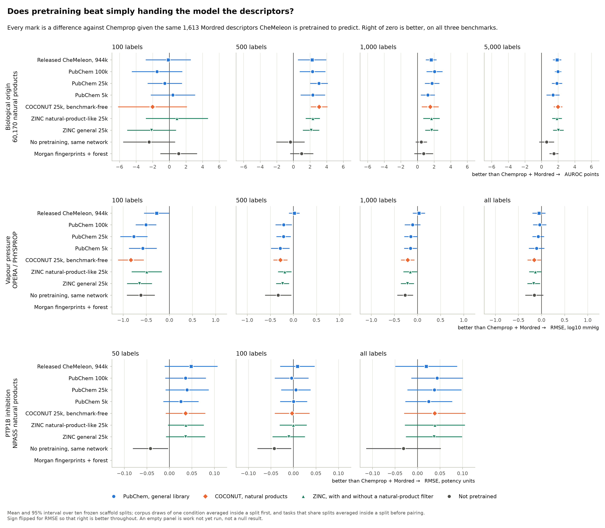

# Three benchmarks, every encoder: methodology and state of the campaign

Written 27 November 2026, **while the runs are still going**. The figure below
is drawn from the cells that exist and redraws itself as the rest land; a panel
reading "not run yet" is work in flight, not a null result. Everything here is
method and provenance, so that the numbers can be read the moment they arrive.

**What the campaign asks.** CheMeleon is pretrained by regressing 1,613 Mordred
descriptors. So the question that decides what any corpus result means is not
"does pretraining help" but **does a pretrained encoder beat a Chemprop model
handed those same descriptors?** If it does not, a corpus effect and a
descriptor effect cannot be told apart, and the corpus question is downstream of
a question nobody has answered.

**The answer so far, on the one benchmark that is finished:** yes, from 500
labels up, by 1 to 3 AUROC points with intervals clear of zero. At 100 labels
nothing separates from anything. This is the opposite of ESOL, where Chemprop
with descriptors matched or beat every encoder we pretrained.



Redraw with `.venv/bin/python scripts/plot_benchmark_panel.py`.

## The three benchmarks

| | Biological origin | Vapour pressure | PTP1B inhibition |
|---|---|---|---|
| **What** | plant / fungal / bacterial provenance | measured vapour pressure at 25 °C | inhibition of protein-tyrosine phosphatase 1B |
| **Molecules** | 60,170 | 2,368 | 457 |
| **Task** | 3 one-vs-rest binary | regression | regression |
| **Label** | AUROC | RMSE, log10(P/mmHg) | RMSE, pIC50 |
| **Budgets** | 100 / 500 / 1,000 / 5,000 | 100 / 500 / 1,000 / all | 50 / 100 / all |
| **Source** | Capecchi & Reymond, from COCONUT | OPERA / EPA PHYSPROP | NPASS v2.0, via NaFM's compound list |
| **State** | **finished**, 1,320+ cells | splits freezing | splits freezing |

All three use ten frozen Murcko-scaffold splits at 0.8 / 0.1 / 0.1, the same
fine-tuning recipe, and the same arms.

## Method

The pipeline is unchanged from Stages A to D; only the corpora and the
benchmarks move.

**Pretraining.** CheMeleon's own recipe and architecture, vendored under
`external/` and called rather than reimplemented: D-MPNN, hidden 2,048, depth 6,
8.7 M encoder parameters, trained to regress 1,613 Mordred descriptors
standardised against `pubchem_n100000_s0`. Nothing about the recipe varies
between arms — only which molecules are in the corpus.

**Arms.** 35 pretrained encoders plus four reference arms:

| Group | Arms | What it isolates |
|---|---|---|
| Size | PubChem at 500 / 1k / 5k / 10k / 25k / 50k / 100k, two draws each | how many molecules are needed |
| Composition | `coconut_noleakskel` 5k and 25k, `zinc_nplike_noleak` 25k, `zinc_general_noleak` 25k, three seeds each | natural products, natural-product-*like*, and ordinary chemistry at one size |
| Proximity | `pubchem_noleak`, `pubchem_nearbench_noleak`, 25k, three seeds | whether a corpus buys nearness to the benchmark rather than chemistry |
| Exposure | `coconut_noleak` 25k, three seeds | the leakage sensitivity check — see below |
| Reference | released CheMeleon (944,286), untrained same-architecture encoder, default Chemprop, **Chemprop + Mordred**, Morgan forest | what pretraining is worth, and against what |

**Fine-tuning.** `scripts/finetune.py`, end to end, every arm on identical
frozen splits and identical label draws, with `label_budget` so that a cell
labelled 100 consumes 100 training labels and 12 validation ones rather than the
whole validation split.

**Statistics.** Differences are paired on the split, because the split moves a
score far more than any arm does. Several corpus draws of one condition are
averaged *inside* a split before pairing — they are draws of that condition, not
extra splits. The three origin tasks share molecules and splits, so they are
averaged inside a split too, and count once. Intervals are 95 % t-intervals over
the ten split-level differences, unadjusted for multiplicity.

**The noise floor.** Two draws of one PubChem corpus at one size contain no
corpus effect, so the spread of their difference is the null distribution of
every corpus contrast. On the origin benchmark, fine-tuned: ±1.48 points at 100
labels, ±0.60 at 500, ±0.92 at 1,000, ±0.65 at 5,000. **Any claimed effect
smaller than that is not a finding.** Full table in
[`noise-floor/README.md`](noise-floor/README.md). The same pairing will be
computed on both new benchmarks before anything is claimed from them.

## Dataset 1 — biological origin (finished)

60,170 natural products from the Capecchi & Reymond release of COCONUT, labelled
plant, fungal or bacterial. Run as three one-vs-rest binary tasks because
`build_model` has no multiclass head. Positive rates 0.561 / 0.260 / 0.179.
Train 48,136 / validation 6,017 / test 6,017.

**Result: COCONUT and PubChem are not told apart**, at either corpus size, at
any budget. Pooled, COCONUT 25k minus PubChem 25k is −1.52 ±5.19, +0.02 ±0.64,
−0.34 ±0.85, −0.10 ±0.48 across the four budgets — every interval containing
zero *and* containing the noise floor's own estimate. The linear probe's hint of
+1.16 at 1,000 labels does not survive fine-tuning. Written up in
[`night-2026-11-27.md`](night-2026-11-27.md).

**Known limits.** Labels come from a priority rule (human > animal > bacteria >
fungi > plant > marine), so a negative means "never reported from", a gap in the
literature rather than a fact about chemistry. The file carries no
stereochemistry at all. A Morgan-fingerprint SVM already reaches ~0.90 balanced
accuracy in the source paper, so the headroom is 10–19 AUROC points, not the
30–40 an earlier note assumed.

## Dataset 2 — vapour pressure (acquired today)

**2,368 molecules**, measured vapour pressure, target log10(P / mmHg).

Acquired from `VP_QR.sdf` inside `OPERA_Data.zip` at
`github.com/kmansouri/OPERA`, the QSAR-ready *experimental* endpoint file behind
Mansouri et al., J Cheminform (2018) 10:10. Archive sha256 and per-step row
counts are in `vapor_pressure.provenance.json`.

**Curation, and where it departs from the published figure.** The endpoint is
usually quoted as ~2,716 structures. This file is 2,368, for one reason worth
stating: OPERA's VP set mixes measurements from 15 to 30 °C and each record
carries its own temperature. **Only rows reading exactly 25 °C were kept.** The
343 rows at other temperatures were dropped rather than extrapolated, because
converting a 20 °C measurement to 25 °C needs an enthalpy of vaporisation the
file does not carry. 108 further records with a blank temperature and a `?`
reference were dropped first.

Units were not assumed: the OPERA README states "VP (Log) in mmHg" for this
endpoint, and `VP_2.9_update.csv` in the same archive carries an explicit unit
column reading mmHg for all 3,945 of its rows on the same scale. No conversion
applied. Range −13.68 to +5.67, median −0.96.

**The split is the worst thing about this task, and it was found by the
adversarial check rather than by the acquisition.** 1,120 of 2,368 molecules
(47 %) are acyclic, and RDKit returns the *empty string* as the Murcko scaffold
for every one of them, so they form a single scaffold group that a scaffold
split cannot divide. It lands whole in train on all ten seeds, so **the test set
contains zero acyclic molecules on every seed**, with a train-to-test label mean
shift of 1.9 to 3.7 log units. Acyclic molecules are also the volatile end of
this benchmark, which is the end a volatility question is about.

Worse for the statistics: the acyclic group plus the benzene-scaffold group is
1,588 of the 1,894 training rows, so **84 % of the training set is identical on
every seed** and the ten splits are not ten independent splits. Train /
validation / test sizes come out byte-identical for all ten.

It is kept and disclosed rather than patched, for three reasons. Every arm is
scored on the same splits, so the paired differences the campaign reports are
unaffected by a biased test set. The same pooling already applies to ESOL (28 %
acyclic) in the committed Stage B and C results, and a different rule here would
make them incomparable. And the PubChem-redraw noise floor measures the lost
independence empirically, so the cost lands in the number that decides what may
be claimed rather than in an assertion. Clustering the acyclic molecules by
fingerprint similarity is the fix, and it is a change to the split recipe, which
is an amendment.

**Other caveats.** Only 4 of 2,368 SMILES carry any stereochemistry, because
OPERA's curation strips it — so every corpus compared on this task must be
excluded on the **connectivity** key. Six rows report a salt or solvate
measurement against the desalted parent structure, the worst being 2,4-D, whose
dimethylamine salt value sits under the free acid's structure and is wrong by
4.9 log units. 89 rows exceed 1 atm, and several of those compounds are above
their critical temperature at 25 °C, so no vapour pressure physically exists for
them (methane at +5.67 is 612 atm). Censoring cannot be audited: there is no
qualifier column, so upstream censoring would be invisible. RMSE here is
dominated by the tails (range −13.68 to +5.67, sd 3.48) and **must not be
compared to OPERA's published RMSE of ~0.7**, which is a different split and
includes the non-25 °C rows.

Seventeen named molecules were checked against published values and match to a
mean absolute error of 0.03 log units (benzene +1.977 vs +1.98, naphthalene
−1.071 vs −1.07), so the structure-to-label join is right.

## Dataset 3 — PTP1B inhibition (acquired today)

**457 natural products**, target pIC50 = −log10(IC50 in mol/L).

**Three molecules were the wrong enzyme entirely, and they were the top of the
potency range.** NPASS v2.0 maps microcystin-LR, tautomycin and okadaic acid to
this target. All three are canonical PP1/PP2A *serine-threonine* phosphatase
inhibitors; PTP1B is a protein *tyrosine* phosphatase. Left in, they would have
been the three easiest and most influential points in a 460-molecule regression,
and every arm would have been scored partly on predicting a mis-annotation.
Removing them moves the maximum from pIC50 9.47 to 6.47 and the standard
deviation from 0.648 to 0.566 — the label range shrinks by a third. Dropped by
`scripts/curate_ptp1b_targets.py`, which matches on molecular formula and
refuses to run if a formula matches anything other than exactly one row. Found
by the adversarial verification, not by the acquisition.

Target identity confirmed rather than inferred: NaFM labels it only `NPT178`,
and both NPASS v2.0 and NPASS 3.0 map `NPT178` to "Protein-tyrosine phosphatase
1B", *Homo sapiens*, UniProt P18031.

**The label is not NaFM's.** This is the campaign's most consequential curation
finding. NaFM's published `activity_value` for this target was reproduced
exactly — 612 of 612 rows to 1e-6 — as `log10(mean of the raw numeric NPASS
IC50 value)`. That is log10(IC50 / nM): **the inverse direction of a pIC50**,
off by the nine-decade nM-to-M offset, pooling units, and treating censored
records as exact. The label here was therefore recomputed from the underlying
NPASS records. Anything comparing a number in this file against a number in the
NaFM paper must undo `pIC50 = 9 − log10(IC50/nM)` first.

**Curation.** Of 1,322 NPASS activity records for this target, only
`activity_type == IC50` is kept (798); Ki (43), Kd (8), percent inhibition (401)
and the rest are dropped rather than pooled. 138 censored records (`>` 109,
`>=` 7, `<` 22) are **dropped, not clamped** — NaFM averaged them in as exact,
which moves 134 of their 612 compounds. 34 records in µg/mL are dropped because
converting them needs a molecular weight; NaFM read their numeric value as if it
were nM. 42 compounds had more than one usable IC50 and were collapsed by
median, with a median spread of 0.26 log units but a **worst case of 4.0 log
units** — a 10,000-fold disagreement between literature reports of one compound.

**Residual contamination, disclosed not removed.** No assay-organism filter was
applied: 3 kept records are *Yersinia enterocolitica*, which is YopH, a
bacterial tyrosine phosphatase and again a different enzyme; 52 carry organism
`n.a.`; about 27 molecules have no human-assayed record at all. Twenty-three
groups covering 47 rows are distinguished from another row by **stereochemistry
alone**, so 457 rows stand on about 433 distinct constitutions — and a corpus
exclusion on the connectivity key collapses pairs this benchmark treats as
different molecules.

**Expect this task to be underpowered, and say so.** 457 molecules means a
scaffold training split of about 365. The budgets are 50 / 100 / all, with no
500 because it does not exist. Label sd is 0.566. The published "612 samples" is
a count of records whose labels are unusable as published, not a count of
molecules with consistent units. Dropping the 138 censored records also biases
the set toward compounds that had a measurable IC50, so genuine inactives are
under-represented.

## Leakage and exclusion

The exclusion rule is the **connectivity key**: stereochemistry stripped from
both sides before matching, because a benchmark carrying no stereochemistry
cannot be compared to a stereospecified corpus any other way. On the origin
benchmark, exact matching finds 15.4 % of the benchmark in COCONUT and
stereo-free matching finds 99.0 %.

| Corpus | vs origin benchmark | Cost |
|---|---|---|
| `coconut_noleakskel_*` | excluded, 0 benchmark molecules in the draw | 129,107 of 670,351 pool molecules, **19.26 %** |
| `pubchem_n*_s*` | **never excluded** | 0, keeps ~1.5 % of each draw |
| `coconut_noleak_*` | excluded against BBBP/ESOL only | ~a fifth of it is origin molecules |

**The asymmetry is real and unfixed.** Making it symmetric means drawing
benchmark-excluded PubChem corpora and pretraining them from scratch, about 8
GPU-hours each, which would displace work already running. It does not explain
the origin result, because the arm that kept its exposure is the one that failed
to pull ahead — but it has to be stated with any number.

The full audit is done: 40 corpora × 5 benchmarks, 200 pairs, in
[`exclusion-audit.md`](exclusion-audit.md) and `exclusion-audit.csv`, rebuilt by
`scripts/exclusion_audit.py`. Three findings change how results must be read.

**The released CheMeleon checkpoint has seen almost everything.** Its
distributed pretraining pool contains **97.9 % of the vapour-pressure
benchmark**, 93.5 % of ESOL and 81.9 % of BBBP, against 2.2–2.5 % for our
25,000-molecule arms — a twenty- to thirty-fold gap. Every "released versus
scratch" number in this project, including the ones already reported, is a
comparison against a model that has seen the test molecules. It is still a fair
*ceiling* for what a big public corpus buys; it is not a clean corpus contrast.

**No arm of any corpus was ever excluded against vapour pressure or PTP1B**,
because neither benchmark existed when any draw was taken. Exposure there is
small (0.0–1.1 % of a corpus) but it is uneven: on PTP1B, COCONUT arms are
twelve times more exposed than PubChem arms, and on vapour pressure the
near-benchmark PubChem arms are six times more exposed than COCONUT.

**All four ZINC families are at exactly zero** against vapour pressure, PTP1B,
BBBP and ESOL, and near-zero against the origin benchmark. So any comparison
involving a ZINC arm is an exposure comparison as well as a chemistry
comparison, in ZINC's disfavour.

## What is launched

State as of 28 November, 02:40. **The campaign has drained; nothing is queued.**

| Campaign | Arms × tasks | Output | State |
|---|---|---|---|
| Origin | 35 arms × 3 | `runs/finetune_a19/` | complete, 4,200 cells scored |
| COCONUT seeds 1 and 2 | 3 pretrainings | `runs/pretrain/` | **finished**; all three clean draws exist |
| New benchmarks, every arm | 30 arms × 2 | `runs/finetune_bench/` | **complete, 2,100/2,100 cells**, every arm `COMPLETED`, none failed |
| Splits + descriptors for the new benchmarks | — | scratch | splits frozen; descriptors cached by `scripts/precompute_task_descriptors.py` |

The 30 new-benchmark arms ran between 00:16 and 02:35 on 28 November. Each is
70 cells: vapour pressure at 4 budgets and PTP1B at 3, ten frozen splits each.
A single arm takes about three minutes of GPU time, so the campaign was never
compute-bound — it was bound by waiting in a queue thirty separate times.

**How the GPU ceiling was raised.** `mit_normal_gpu` caps one user at
`gres/gpu=2`, which no amount of submitting can exceed. `mit_preemptable` is a
separate budget of `gres/gpu=4`, so the two together hold six. The new-benchmark
work was moved there with `--requeue`, which is safe because `finetune.py` skips
a cell whose `predictions.csv` already exists and `identity_mismatch()` verifies
the manifest before trusting that skip. One trap: a site submit plugin rewrites
a generic `--gres=gpu:1` to `gpu:l40s:1`, so every job queued for one GPU model
while a100/h100/h200 capacity sat idle; explicit types *are* honoured, and the
arms were spread round-robin across all four. `slurm/finetune-tasks-anygpu.sbatch`
is that variant, kept separate so the shared sbatch other jobs depended on was
never edited mid-flight.

**Arms removed on 27 November, to stay inside the GPU quota.** Sixteen
submissions were cancelled while still pending, on the instruction to cut
anything not answering the three benchmarks: `pubchem_nearbench_noleak_n25000`
(all three draws, both campaigns), `coconut_noleakskel_n5000` (both campaigns),
`pubchem_noleak_n100000`, and `coconut_noleak_n25000` on the two new benchmarks
only. The lines are preserved verbatim in `runs/slurm/removed-2026-11-27.txt`
and can be resubmitted from there.

Two consequences a reader must carry. **Proximity is no longer measured on these
benchmarks:** `pubchem_nearbench` was the arm that would have separated "natural
products help" from "chemistry resembling the test set helps", so that
alternative explanation is now open and untested rather than ruled out. And
**composition is tested at one corpus size only**, 25,000, since the 5,000-molecule
natural-product arm is gone from the origin campaign's remaining work.

**A practical constraint worth recording:** `mit_normal_gpu` accepts at most 64
submitted jobs per user. The first full submission died partway through with
`QOSMaxSubmitJobPerUserLimit`, losing the tail of the list with one line on
stderr. Two fixes: `slurm/finetune-tasks.sbatch` packs every task of one encoder
into a single job, and `slurm/topup-gpu.sh` feeds a work list in as slots free,
skipping any line whose splits are not frozen yet. Job ids accumulate in
`runs/slurm/a19-jobs.txt`.

## First result on the two new benchmarks

Scored 28 November from 2,100 cells with
`scripts/evaluate.py runs/finetune_bench --baseline chemprop_descriptors --baseline scratch`.
The figure is `docs/figures/benchmark_panel.png`.

**No encoder beats Chemprop handed the Mordred descriptors, on either new
benchmark, at any label budget.** Not one of the 29 non-reference arms has a
paired 95 percent interval clearing zero. This is the comparison that matters:
CheMeleon pretrains by regressing those same 1,613 descriptors, so an encoder
that beats a fingerprint but not a model given the descriptors directly has
shown a descriptor effect and not a corpus effect.

The best arm in each block, as a paired difference against
`chemprop_descriptors` over ten splits, negated so that positive means better:

| Task | Labels | Best arm | Difference | 95% half-width |
|---|---|---|---|---|
| PTP1B | 50 | `pubchem_noleak_n25000_s2` | +0.0511 | 0.0520 |
| PTP1B | 100 | `zinc_nplike_noleak_n25000_s2` | +0.0139 | 0.0332 |
| PTP1B | all | `pubchem_n50000_s0` | +0.0502 | 0.0610 |
| Vapour pressure | 100 | `chemprop` | −0.1867 | 0.2634 |
| Vapour pressure | 500 | `released` | +0.0175 | 0.1149 |
| Vapour pressure | 1,000 | `released` | +0.0307 | 0.1337 |
| Vapour pressure | all | `pubchem_n100000_s0` | −0.0298 | 0.1536 |

Two things are worth saying plainly. On vapour pressure the descriptor baseline
is simply the strongest thing in the campaign — most arms sit left of zero, and
the best of them only reaches a tie. And on PTP1B the arms that come closest are
PubChem and ZINC draws, **not** the natural-product corpus, which is the opposite
of what a natural-product-corpus advantage would look like.

Contrast this with the origin row of the same figure, where pretrained encoders
*do* beat the descriptor baseline by roughly two AUROC points at 500 labels and
above — consistently, across PubChem, the benchmark-free COCONUT draws and both
ZINC arms alike. Pretraining helps there. It does not transfer to these two.

### The noise floor, and one budget that fails it

`scripts/benchmark_noise_floor.py` takes `pubchem_n25000_s0` minus
`pubchem_n25000_s1` — two draws of one corpus at one size, paired on task,
split and budget. No corpus effect can live in that difference, so its spread is
the null distribution of a corpus contrast in this design, and its 95 percent
half-width is the smallest effect the design can tell from a redraw.

| Task | Labels | Floor mean | sd | Half-width | Floor itself nonzero? |
|---|---|---|---|---|---|
| PTP1B | 50 | +0.0040 | 0.0154 | 0.0110 | no |
| PTP1B | 100 | +0.0119 | 0.0341 | 0.0244 | no |
| PTP1B | all | −0.0055 | 0.0224 | 0.0160 | no |
| Vapour pressure | 100 | **+0.1466** | 0.1692 | **0.1210** | **yes** |
| Vapour pressure | 500 | +0.0121 | 0.1133 | 0.0810 | no |
| Vapour pressure | 1,000 | +0.0337 | 0.0948 | 0.0678 | no |
| Vapour pressure | all | +0.0415 | 0.0652 | 0.0467 | no |

**Vapour pressure at 100 labels does not pass its own sanity check.** Two draws
of the same corpus differ there by more than their interval allows. Since the
only thing separating those two encoders is the random draw of pretraining
molecules, that gap cannot be a corpus effect — it says the 100-label vapour
pressure cell is noisy enough to manufacture an apparently significant
difference out of nothing. **Nothing at that budget should be interpreted, in
either direction**, including the negative results above. The likely cause is
the split problem already recorded below: acyclic molecules all share the empty
Murcko scaffold, so the vapour pressure splits are lumpier than intended, and
the effect is worst where the training set is smallest.

The other six task-and-budget blocks pass. Their floors are small relative to
the contrasts in the table above, so the finding that nothing beats the
descriptors is a real null at those budgets and not a failure to measure.

### Two bugs fixed in the figure, both silent

`plot_benchmark_panel.py` joined arm against reference on `label_count`, and
polars does not match null to null unless asked. The all-labels budget *is* a
null `label_count`, so every `nall` cell failed to pair and both all-labels
panels drew themselves empty — which this figure's own caption tells the reader
means "not yet run". A dropped result looked exactly like a missing one. The
join now passes `nulls_equal=True`.

The same loader also crashed outright when the two campaigns' CSVs disagreed on
whether a column was `Int64` or `Float64`, which happens whenever one file has a
null in a column the other has filled. Every integer column is now widened to
`Float64` before concatenation.

The `runs/finetune_a19/results_per_run.csv` in the repository was also stale —
1,320 rows against 4,201 cells on disk — so the origin row of any figure drawn
before 28 November predates ZINC, `released`, `scratch` and the Morgan forest.
It has been rescored to 4,200 rows.

## Issues a reader must carry

1. **The new benchmarks have no noise floor yet.** Until the PubChem-redraw
   pairing is computed on each, nothing on them is interpretable. 457 molecules
   on PTP1B will almost certainly give a floor wider than any effect worth
   finding; that is a result about the benchmark, and should be reported as one.
2. **The vapour-pressure test set contains no acyclic molecules on any seed**,
   and 84 % of its training set is shared across all ten. Paired contrasts
   survive this; seed-to-seed intervals do not, and will read narrower than the
   truth.
3. **The released checkpoint has seen 98 % of the vapour-pressure benchmark**,
   93 % of ESOL and 82 % of BBBP. Treat it as a ceiling, never as a corpus arm.
4. **The exclusion asymmetry on the origin benchmark**, and the fact that no
   corpus was ever excluded against either new benchmark.
5. **PTP1B's label disagrees with its own source paper**, deliberately. Any
   comparison against published NaFM numbers needs the conversion stated above.
   Three mis-annotated rows were removed after acquisition; residual
   organism contamination is disclosed, not removed.
6. **Vapour pressure is 2,368, not 2,716**, because of the 25 °C filter. It is a
   different task from the one the paper scores, and its RMSE is not comparable
   to OPERA's published ~0.7.
7. **Replicate disagreement on PTP1B reaches 4.0 log units** for one compound.
   That is an irreducible ceiling on what any model can score.
8. **`coconut_noleak` is not a COCONUT arm.** It is the exposed corpus, included
   as a leakage sensitivity check. It must never be quoted as "COCONUT".
9. **Three origin tasks are one benchmark read three times.** They share
   molecules and splits, so they buy no multiple-testing credit.
10. **`runs/slurm/a19-code.sha256` no longer verifies for `scripts/probe.py`.**
    The file was changed on 26 November to compute Mordred in parallel and
    committed, after the digest was taken. Two of the verification agents found
    this independently. The 486 first-pass probe cells ran under the recorded
    digest; the 27 Mordred cells ran under the changed file, whose digest is now
    recorded beside it in `a19-code-after-mordred.sha256`. The change touched
    only `features_mordred`, so no other arm is affected, but the campaign has
    two code versions and the record has to say so.
11. **Nothing here is a registered amendment.** Amendment 19 covers the origin
   benchmark; the two new benchmarks are not in `docs/protocol.md` and were
   added after the origin scores were read. They are exploratory until an
   amendment says otherwise, and Léonard has signed none of 16 to 19.

## Reproducing

```
.venv/bin/python scripts/plot_benchmark_panel.py          # the figure above
.venv/bin/python scripts/np_origin_paired.py   runs/finetune_a19/results_per_run.csv
.venv/bin/python scripts/np_origin_noise_floor.py runs/finetune_a19/results_per_run.csv
sbatch slurm/new-benchmarks-prep.sbatch                   # splits + descriptors
bash   slurm/topup-gpu.sh                                 # feed the work list
```
